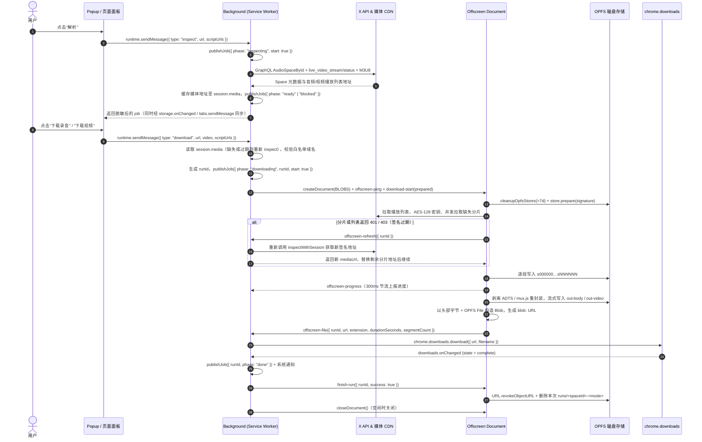
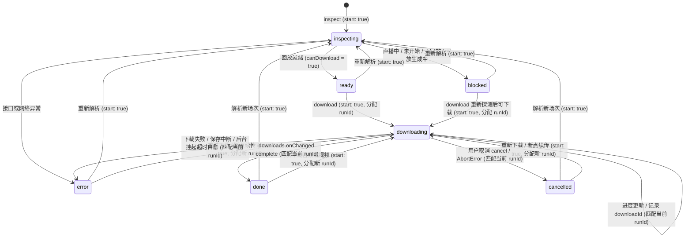

# 架构说明

本文档说明扩展各运行上下文、核心模块、状态同步机制、断点续传与内存模型，以及安全边界设计。

## 组件与职责

### `src/background.js`（Service Worker）

扩展的后台协调中心（ES Module），不直接执行分片下载与音视频封装，避免因 MV3 Service Worker 空闲挂起而中断长任务：

- **X 会话管理**：优先通过 `chrome.cookies.get` 读取 `x.com` / `twitter.com` 的 `auth_token` 与 `ct0`；两者俱全时以登录态调用 X API（附带 `credentials: "include"` 与 `x-csrf-token`）。未登录或登录态返回 401/403 时，自动调用 `guest/activate.json` 获取访客令牌并缓存在 `chrome.storage.session` 的 `guest` 键中（有效期 90 分钟，失效时强制刷新一次）。
- **`queryId` 自动发现**：优先使用 `chrome.storage.local` 中缓存的 `queryId`（默认回退 `DEFAULT_QUERY_ID`）请求 GraphQL `AudioSpaceById`。当接口报操作名/查询失效时，按权重筛选前端传入的页面脚本 URL（或抓取 `https://x.com/` 提取客户端 bundle URL），用正则匹配最新的 `AudioSpaceById` `queryId` 并写回 `chrome.storage.local` 后自动重试。
- **会话级请求头改写**：启动时调用 `chrome.declarativeNetRequest.updateSessionRules` 注册会话规则（ID `1`），仅针对 `tabIds: [-1]`、`resourceTypes: ["xmlhttprequest"]` 且目标域名为 `x.com`、`twitter.com`、`pscp.tv`、`twimg.com` 的请求设置 `Origin: https://x.com` 与 `Referer: https://x.com/`。由于限定了 `tabIds: [-1]`，该规则只作用于扩展自身（Service Worker 与 Offscreen 文档）发出的请求，绝不修改任何网页标签页的请求头。
- **任务状态与单任务互斥**：通过 `src/lib/job.js` 将当前卡片与下载状态写入 `chrome.storage.session` 的 `job` 键。同一时间只允许一个活跃下载任务（由 `starting` 锁与 `runAlive()` 检查 Offscreen 运行状态或 `chrome.downloads` 进度共同保证）；若另一场 Space 正在下载，新的解析或下载请求会抛出 `busy` 错误。`getJob` 在发现任务停留在 `downloading` 超过 20 秒且实际已停止时，自动将其修复为可续传的 `error` 状态。
- **状态广播与角标**：监听 `chrome.storage.onChanged`（`session.job`），更新工具栏图标角标（下载中显示蓝色百分比或 `…`，完成后显示绿色 `OK` 4 秒），并通过 `chrome.tabs.sendMessage` 向已打开的 Space 标签页广播 `{ type: "job", job }`。
- **文件落盘与收尾**：收到 Offscreen 发来的 `offscreen-file`（携带 `blob:` URL）后调用 `chrome.downloads.download` 保存文件，并通过 `chrome.downloads.onChanged` 监听完成或中断事件：保存成功后发送系统通知、通知 Offscreen 释放 `blob:` URL、删除对应 OPFS 分片目录并在空闲时关闭 Offscreen 文档；若保存失败或被取消，则保留 OPFS 分片以便续传。此外在 `runtime.onInstalled` 时清理 1.0.x 遗留的 `x-space-downloader` IndexedDB。

### `src/offscreen.html` 与 `src/offscreen.js`（Offscreen Document）

以 `BLOBS` 原因按需创建的离屏文档，先通过 `<script>` 加载 `src/vendor/mux-mp4.min.js`（注入 `globalThis.muxjs`），再以模块方式运行 `src/offscreen.js`：

- 启动下载前调用 `cleanupOpfsStores` 清理超过 7 天未更新的历史 OPFS 目录，然后打开当前任务专属的 `createOpfsStore("<spaceId>-<mode>")`。
- 若开启了音频元数据且存在主持人头像 URL，先拉取封面并校验 JPEG/PNG 魔数。
- 调用 `src/lib/hls.js` 的 `downloadRecording()` 拉取播放列表与全部分片、解密、抽取或重封装音视频，生成由磁盘文件片段拼装的 `Blob`，调用 `URL.createObjectURL(file.blob)` 生成临时地址并通过 `offscreen-file` 消息交给后台保存。
- 使用 300 ms 节流器通过 `offscreen-progress` 上报分片与合成进度（阶段切换立即发送）。
- 当遇到分片或播放列表签名过期（401/403）时，通过 `offscreen-refresh` 请求后台重新解析最新媒体地址。

### 界面与内容脚本

- **`src/popup.html`、`src/popup.css`、`src/popup.js`**：工具栏弹窗。打开时读取当前活动标签页 URL、后台 `get-job` 状态与用户设置；若当前活动页是 Space 页面，向内容脚本发送 `collect-scripts` 收集脚本地址供 `queryId` 自愈使用，并在需要时自动触发解析。通过监听 `chrome.storage.onChanged` 实时刷新进度。
- **`src/options.html`、`src/options.css`、`src/options.js`**：嵌入式设置面板（`open_in_tab: false`）。编辑保存子目录、文件名模板（带实时路径预览）、视频格式、最大并发数、元数据开关与页面面板开关。
- **`src/content.js` 与 `src/content/panel.js`**：内容脚本不支持直接声明为 ES Module，`src/content.js` 作为经典加载器通过动态 `import(chrome.runtime.getURL("src/content/panel.js"))` 按需加载真正的面板模块（相关模块列在 `manifest.json` 的 `web_accessible_resources` 中）。`panel.js` 使用开放模式的 Shadow DOM（`:host { all: initial; }`）在 `/i/spaces/<id>` 页面右下角渲染悬浮面板；通过 Navigation API（`navigation.addEventListener("currententrychange")`）、`popstate` 与 2 秒一次的本地 `location.href` 字符串比对感知 X 的 SPA 路由切换（不唤醒后台）；通过读取 `document.body` 背景色亮度并配合 `MutationObserver` 自动同步 X 的浅色/深色主题。
- **`src/ui/view.js`**：弹窗与页面悬浮面板共用的视图渲染函数（`renderJob`、`renderBusyElsewhere`、`describeJob`、`showBusy`、`showFailure`、`setMessage`），统一管理按钮禁用态、进度条 `aria-valuenow` 与状态文案。

### `src/lib/*` 与 `src/vendor/*` 模块说明

- `src/lib/x-api.js`：封装 X GraphQL `AudioSpaceById` 与 `live_video_stream/status/<mediaKey>` 请求、主从播放列表探测、视频体积估算、`presentable()` 敏感字段剥离，以及客户端脚本中的 `queryId` 搜索算法。
- `src/lib/hls.js`：M3U8 主播放列表与媒体播放列表解析（支持 `EXT-X-STREAM-INF`、`EXT-X-MEDIA`、`EXT-X-BYTERANGE`、`EXT-X-MAP`、`EXT-X-KEY` AES-128 解密）、设备自适应并发计算（`deviceConcurrency`）、动态并发调度与过期重签恢复（`adaptiveMap`）、格式嗅探（`sniff`）以及最终容器组装（`assembleAac`、`remuxTs`、原始 TS / fMP4 拼接）。
- `src/lib/m4a.js`：跨分片剥离 Space `.aac` 分片头部的 Apple ID3 时间戳标签与 ADTS 帧头（`createAacCollector`），直接构建包含采样表（`stsd`/`stts`/`stsc`/`stsz`/`stco`）及可选 iTunes 元数据盒（`udta/meta/ilst`，含标题、艺术家、专辑、日期、备注与 `covr` 封面）的 `ftyp + moov + mdat` 文件头（`m4aHeader`）。
- `src/lib/ts-audio.js`：解析 188 字节对齐的 MPEG-TS 包（PAT -> PMT -> PES），从中无损提取 ADTS AAC 裸流（流类型 `0x0f`；遇到 `0x11` LATM 封装时给出改下视频的明确报错）。
- `src/lib/remux.js`：包装 `mux.js` 的 `Transmuxer`（`createTsRemuxer`），在不重编码的前提下把 MPEG-TS 分片流式转换为 fMP4 初始化段（`initSegment`）与媒体片段。
- `src/lib/store.js`：分片与合成产物存储接口，提供运行时的 OPFS 实现（`createOpfsStore`、`removeOpfsStore`、`cleanupOpfsStores`）与单测使用的内存实现（`createMemoryStore`）。
- `src/lib/job.js`：纯函数状态转移守卫 `nextJob()`，以及基于 Promise 队列串行化读写 `chrome.storage.session.job` 的 `publishJob()` / `readJob()`。
- `src/lib/net.js`：媒体域名白名单校验（`isAllowedMediaUrl`、`assertMediaUrl`）、带父级 `AbortSignal` 级联的超时请求封装（`fetchWithTimeout`）及可重试错误判定（`retryableError`）。
- `src/lib/format.js`：时间戳、时长、字节数、状态文案、进度百分比格式化，以及文件名模板替换（`fileBase`）与目录/文件名安全清洗（`sanitize`、`sanitizeFolder`）。
- `src/lib/settings.js`：默认设置常量、边界归一化（`normalizeSettings`）与 `chrome.storage.sync` 读写封装。
- `src/lib/i18n.js`：基于 `navigator.language` 选择的中英双语词典、`t()` 占位符替换及 `applyI18n()` DOM 绑定。
- `src/lib/space-url.js`：从完整链接、无协议链接或裸 ID 中提取校验 Space ID（`spaceIdFromText`），并生成标准链接（`spacePageUrl`）。
- `src/lib/bytes.js`：二进制拼接（`concat`）、大端序整数编码（`u16`、`u32`）、ASCII 编码与 ISO BMFF `box()` 构造工具。
- `src/lib/errors.js`：带错误码 `code` 的 `SpaceError` 类型及异常归一化函数 `asSpaceError()`。
- `src/vendor/mux-mp4.min.js`：由 `npm run vendor` 从 `mux.js` 拷贝的浏览器端预编译包，供 Offscreen 页面在无打包器条件下直接加载。

## 下载全流程时序图

## 任务状态机（Job State Machine）

任务状态保存在 `chrome.storage.session` 的 `job` 键中，所有写入统一经过 `src/lib/job.js` 的 `nextJob(prev, partial)` 校验：

1. **`start: true` 开启新轮次**：`inspect`（进入 `inspecting`）和 `startDownload`（生成新 `runId` 并进入 `downloading`）在确认当前没有正在运行的任务后传入 `start: true`，开启新的卡片或下载轮次。
2. **携带 `runId` 的更新仅在对应轮次下载中生效**：当 `!start` 且更新对象带有 `runId` 时，只有 `current.phase === "downloading"` 且 `current.runId === patch.runId` 才允许写入，否则直接丢弃（返回 `null`）。这保证了用户点击取消使状态变为 `cancelled` 后，Offscreen 延迟到达的进度或 `done` 更新绝不会把 `cancelled` 覆盖回完成状态。
3. **无 `runId` 的卡片更新绝不打断活跃下载**：当 `!start` 且不带 `runId` 时，若 `current.phase === "downloading"` 则一律忽略，避免无关解析结果或非下载类异常覆盖正在进行的下载状态。

## 消息协议表

扩展内通过 `chrome.runtime.sendMessage` 与 `chrome.tabs.sendMessage` 通信，全部消息类型如下：

| 消息 `type`          | 发送方 -> 接收方                   | 主要参数                                                                                                         | 用途与响应                                                                                                             |
| -------------------- | ---------------------------------- | ---------------------------------------------------------------------------------------------------------------- | ---------------------------------------------------------------------------------------------------------------------- |
| `inspect`            | Popup / Panel -> Background        | `url`, `scriptUrls`                                                                                              | 解析指定 Space 元数据与播放列表可用性，返回 `{ ok, job }`。                                                            |
| `download`           | Popup / Panel -> Background        | `url`, `video`, `scriptUrls`                                                                                     | 启动音频（`video: false`）或视频（`video: true`）下载任务，返回 `{ ok, job }`。                                        |
| `cancel`             | Popup / Panel -> Background        | `url`, `scriptUrls`                                                                                              | 取消当前正在进行的下载（中止 Offscreen 拉取及浏览器保存），返回 `{ ok, job }`。                                        |
| `get-job`            | Popup / Panel -> Background        | 无                                                                                                               | 读取当前 `session.job`，若发现陈旧卡死的 `downloading` 任务则自动修复为 `error` 后返回。                               |
| `collect-scripts`    | Popup -> Content (`panel.js`)      | 无                                                                                                               | 弹窗通过 `chrome.tabs.sendMessage` 向当前活动 Space 标签页索取页面上的 `<script src>` 列表，用于 `queryId` 自动发现。  |
| `job`                | Background -> Content (`panel.js`) | `job`                                                                                                            | 当 `chrome.storage.session.job` 变化时，后台通过 `chrome.tabs.sendMessage` 向所有匹配的 Space 标签页推送最新任务状态。 |
| `offscreen-ping`     | Background -> Offscreen            | 无                                                                                                               | 探测 Offscreen 文档是否已就绪及是否有任务在运行，返回 `{ ready, running, runId }`。                                    |
| `download-start`     | Background -> Offscreen            | `prepared`（含 `runId`, `spaceId`, `mode`, `mediaUrl`, `storeKey`, `maxConcurrency`, `videoFormat`, `metadata`） | 指示 Offscreen 开始执行指定轮次的 HLS 下载与封装。                                                                     |
| `download-cancel`    | Background -> Offscreen            | `runId`                                                                                                          | 触发对应 `runId` 的 `AbortController.abort()` 并回收未完成的临时 `blob:` URL。                                         |
| `finish-run`         | Background -> Offscreen            | `runId`, `success`                                                                                               | 撤销已生成的 `blob:` URL；当 `success: true` 时删除该轮对应的 OPFS 目录。                                              |
| `offscreen-progress` | Offscreen -> Background            | `runId`, `progress`                                                                                              | 上报 `playlist` / `segment` / `mux` 阶段进度与实时并发路数。                                                           |
| `offscreen-file`     | Offscreen -> Background            | `runId`, `url`, `extension`, `durationSeconds`, `segmentCount`, `size`                                           | 通知后台文件已拼装完毕，传递 `blob:` URL 由后台调用 `chrome.downloads.download`。                                      |
| `offscreen-error`    | Offscreen -> Background            | `runId`, `code`, `message`                                                                                       | 上报下载或合成异常（含取消错误码 `cancelled`），由后台更新 `job` 状态。                                                |
| `offscreen-refresh`  | Offscreen -> Background            | `runId`                                                                                                          | 分片遇到 401/403 时请求后台重新解析该 Space 并返回新的签名 `mediaUrl`。                                                |

## 存储映射表

| 存储区域                 | 键 / 路径                | 生命周期与清理策略                                                                                                   | 保存内容                                                                                                         |
| ------------------------ | ------------------------ | -------------------------------------------------------------------------------------------------------------------- | ---------------------------------------------------------------------------------------------------------------- |
| `chrome.storage.session` | `job`                    | 浏览器会话期间驻留，关闭浏览器自动清空                                                                               | 当前 Space 卡片信息与下载任务状态（不含媒体流签名 URL 与 `mediaKey`）。                                          |
| `chrome.storage.session` | `guest`                  | 缓存 90 分钟（`GUEST_TTL_MS`）或认证失败时刷新                                                                       | X 访客令牌 `{ token, at }`。                                                                                     |
| `chrome.storage.session` | `media`                  | 缓存 10 分钟（`MEDIA_TTL_MS`）                                                                                       | 最近一次解析得到的真实播放列表地址 `{ spaceId, audio, video, at }`，仅供后台内部消费。                           |
| `chrome.storage.local`   | `queryId`                | 持久化保存，接口轮换重新发现时覆盖                                                                                   | 自动提取的 `AudioSpaceById` GraphQL `queryId`。                                                                  |
| `chrome.storage.sync`    | `settings`               | 持久化保存，随浏览器账号同步                                                                                         | 用户设置（`folder`, `template`, `showPanel`, `maxConcurrency`, `videoFormat`, `embedMetadata`）。                |
| OPFS（源私有文件系统）   | `runs/<spaceId>-<mode>/` | `finish-run(success: true)` 时立即删除；残留目录在下次启动下载时若 `updatedAt` 超过 7 天（`STALE_RUN_MS`）则自动清理 | `meta.json`（存储签名与更新时间）、`s000000`…`sNNNNNN`（已下载分片）、`out-body` / `out-video`（流式合成产物）。 |

## 断点续传设计

每个下载任务按 `<spaceId>-<mode>`（如 `1OwxWwQOPlNxQ-audio` 或 `1OwxWwQOPlNxQ-video`）隔离在独立的 OPFS 子目录中，避免不同场次或同场音视频模式互相串扰：

1. **播放列表签名校验**：解析出媒体播放列表后，`downloadRecording()` 提取 `{ mode, total, first, last }` 作为存储签名（其中 `first` 与 `last` 为首尾分片 URL 的文件名部分，不含签名查询串，因此 URL 重签刷新后签名保持不变）。
2. **不匹配自动清空**：`store.prepare(signature)` 读取目录内的 `meta.json`；若已存在的签名与当前播放列表不一致，立即递归删除旧目录并重建，防止混入不同版本的分片。
3. **原子落盘与缺失补齐**：写入分片时使用 OPFS 的 `FileSystemFileHandle.createWritable()`，浏览器仅在 `writable.close()` 时原子提交文件。因此目录中凡是匹配 `^s\d{6}$` 的分片文件均保证完整可用；`store.completed()` 扫描已完成序号集合后，仅将缺失序号送入 `adaptiveMap` 队列下载。

## 内存模型设计

为支持数小时长的音频或视频 Space 而不撑爆扩展进程内存，下载与封装全程采用磁盘支撑的流式设计：

- **分片落盘**：下载阶段每个分片解密（并在音频模式下从 TS 抽取 ADTS）后立即写入 OPFS 独立文件 `sNNNNNN`，不在内存中驻留分片数组。
- **音频 `.m4a` 合成（`assembleAac`）**：按序逐个从 OPFS 读取分片，经 `createAacCollector()` 剥离 ID3 标签与 ADTS 头后，将裸 AAC 数据直接写入 OPFS 的 `out-body` 文件流；内存中**仅保留每帧的字节长度数组 `lengths`** 用于计算 MP4 `stsz` 采样表。全部写完后，先在内存生成紧凑的 `ftyp + moov + mdat(8字节头)`，再通过 `new Blob([m4aHeader(...), await store.file("body")])` 将内存头部与磁盘 `File` 句柄零拷贝组合为最终 `Blob`。
- **视频重封装与直出**：MP4 视频重封装（`remuxTs`）按分片逐段送入 `mux.js`，把输出的媒体片段流式写入 OPFS `out-video`，最终以 `new Blob([remuxer.init, await store.file("video")])` 组合；原始 `.ts` 视频与原生 `fMP4` 回放则直接通过 `store.segmentFile(i)` 取得磁盘 `File` 句柄列表拼成 `Blob`。

## 安全设计要点

- **媒体域名白名单与强制 HTTPS**：`src/lib/net.js` 的 `isAllowedMediaUrl()` 强制要求协议为 `https:`，且主机名必须属于 `pscp.tv` 或 `twimg.com`（含子域名），与 `manifest.json` 的 `host_permissions` 保持一致。播放列表、媒体分片、AES-128 密钥及封面图请求前均经过校验。
- **后台绝不信任外部消息传入的媒体地址**：`presentable()` 在向前端返回 `job` 前删除了 `audioMediaUrl`、`videoMediaUrl` 与 `mediaKey`；`startDownload` 只从后台自己的 `chrome.storage.session.media` 缓存或重新调用的 `inspectWithSession()` 中获取播放列表 URL，忽略消息体中的任何媒体地址字段，杜绝内容脚本被页面干扰后诱导后台下载任意 URL。
- **Offscreen 消息来源校验**：`src/background.js` 对所有 `offscreen-*` 消息严格校验 `sender.url === chrome.runtime.getURL("src/offscreen.html")`，拒绝来自网页内容脚本或其他上下文的伪造进度、文件或刷新请求。
- **精确作用域的请求头改写**：放弃全局静态 `declarativeNetRequest` 规则，改用限定 `tabIds: [-1]` 的会话级规则，确保任意第三方网站向 `x.com` 或 `twimg.com` 发起 XHR 时不会因安装了本扩展而被篡改 `Origin` / `Referer`。
